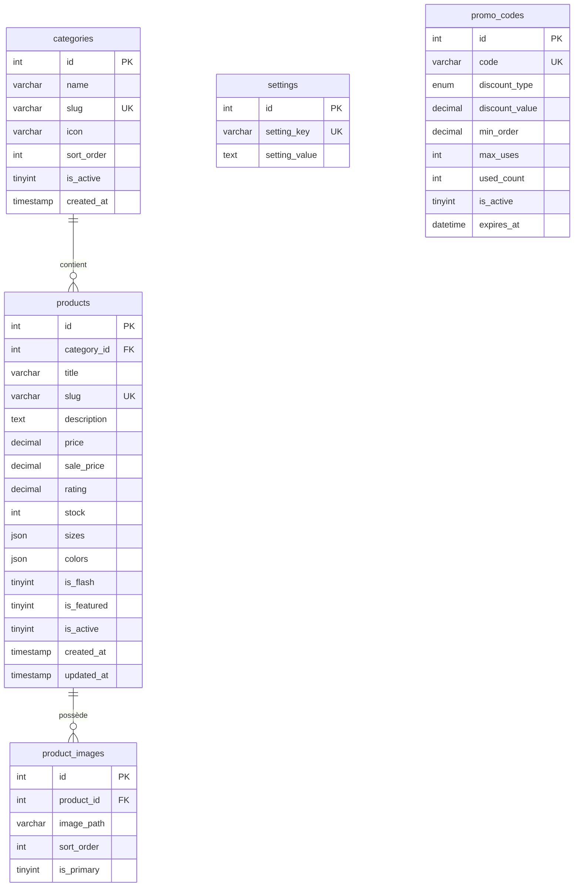

# Newstylesafi

Boutique de mode homme **PHP 8 + MySQL**, sans framework ni dépendance externe.
Le catalogue est public, le panier et les favoris vivent en session, et la
commande est confirmée sur **WhatsApp** : aucun compte client, aucun paiement
en ligne et aucune donnée client stockée en base.

Interface en français, devise **DH**, thème clair et accents terracotta.

---

## Sommaire

- [Fonctionnalités](#fonctionnalités)
- [Stack](#stack)
- [Structure](#structure)
- [Schéma de la base](#schéma-de-la-base)
- [Installation locale](#installation-locale)
- [Configuration](#configuration)
- [Espace de gestion](#espace-de-gestion)
- [Sécurité](#sécurité)
- [Performance](#performance)
- [Déploiement](#déploiement)
- [Journal](#journal)

---

## Fonctionnalités

- Catalogue par catégories, recherche instantanée et filtres.
- Fiche produit : galerie plein écran, tailles, couleurs, stock et produits liés.
- Panier et favoris conservés en session, sans création de compte.
- Commande guidée : coordonnées de livraison, récapitulatif, puis WhatsApp.
- Administration protégée : produits, photos, couleurs, catégories et réseaux.
- Jusqu’à 8 photos par produit, avec choix de la photo principale.
- Sélecteur de catégorie illustré par des icônes dans le formulaire produit.
- Recherche admin par titre, slug ou catégorie.
- Catégories réordonnables ; l’ordre par défaut est **1**.
- Liens propres (`/produits`) avec repli automatique (`/?p=/produits`).
- Aucun CDN, aucune police distante, aucune étape de build.

---

## Stack

| Couche | Choix |
|---|---|
| Backend | PHP 8.1+, PDO, MVC léger maison |
| Base | MySQL 8 / MariaDB 10.4+, `utf8mb4` |
| Front | HTML sémantique, CSS Grid/Flexbox, JavaScript vanilla |
| Assets | SVG inline, polices système, cache par version de fichier |
| Hébergement | Apache mutualisé ou serveur PHP intégré |

---

## Structure

```text
/
├── index.php              Point d’entrée unique
├── .htaccess              URLs propres et blocage des dossiers sensibles
├── config.php             Réglages du site et accès à la base
├── assets/                CSS, JS, images et polices
├── uploads/               Photos produits (scripts désactivés)
├── app/
│   ├── bootstrap.php      Autoload, erreurs, en-têtes de sécurité
│   ├── routes.php         Table des URLs
│   ├── core/              Router, View, Database, Session
│   ├── controllers/       Pages publiques et administration
│   ├── models/            Requêtes SQL
│   ├── helpers/           Fonctions de template et icônes SVG
│   └── views/             Layouts, partiels et pages
├── database/
│   ├── newstylesafi.sql   Structure + données de démonstration
│   └── schema.sql         Structure seule, sans données
├── storage/               Cache et journaux
└── tools/                 Scripts de développement
```

---

## Schéma de la base



Points importants :

- `products.category_id` passe à `NULL` si sa catégorie est supprimée.
- Les images d’un produit sont supprimées avec le produit (`ON DELETE CASCADE`).
- `sizes` et `colors` sont des tableaux JSON validés par MySQL.
- `settings` est une table clé/valeur pour les réglages globaux.
- **Pas de tables `customers` ou `orders`** : le panier et les favoris restent
  en session, et la commande est transmise à WhatsApp sans être enregistrée.

---

## Installation locale

Prérequis : PHP 8.1+ avec `pdo_mysql`, MySQL 8 ou MariaDB 10.4+.

1. Créer et importer la base :

   ```bash
   mysql -u root -e "CREATE DATABASE newstylesafi CHARACTER SET utf8mb4 COLLATE utf8mb4_unicode_ci;"
   mysql -u root newstylesafi < database/newstylesafi.sql
   ```

   Pour une base vide, utiliser `database/schema.sql` à la place.

2. Renseigner la connexion MySQL dans la section **C. DATABASE** de
   `config.php` :

   ```php
   'db_host' => '127.0.0.1',
   'db_name' => 'newstylesafi',
   'db_user' => 'root',
   'db_pass' => '',
   ```

3. Ouvrir le site :

   ```text
   http://localhost/newstylesafi/
   ```

   Ou lancer le serveur intégré :

   ```bash
   php -S 127.0.0.1:8080 tools/dev-router.php
   ```

Le dump de démonstration contient six catégories et douze produits fictifs.
Les remplacer depuis l’administration avant la mise en ligne.

---

## Configuration

Tout se règle dans `config.php`, à la racine. Les valeurs sensibles doivent
être remplacées avant la mise en ligne :

| Réglage | Rôle |
|---|---|
| `app_name`, `brand_split` | Nom de la boutique et découpe du logo texte |
| `admin_path` | Dossier de l’administration (par défaut `gestion`) |
| `admin_email`, `admin_password` | Identifiants de l’administration |
| `whatsapp_number` | Numéro qui reçoit les commandes, indicatif inclus |
| `db_host`, `db_port`, `db_name`, `db_user`, `db_pass` | Connexion MySQL |
| `free_shipping_threshold` | Seuil de livraison offerte, en DH |
| `app_debug` | Erreurs à l’écran : `true` uniquement pendant l’installation |

> **Avant toute publication**, remplacer les identifiants de démonstration
> par un mot de passe long et unique, et vérifier que `app_debug` est à
> `false`. Ne jamais publier un `config.php` contenant de vrais secrets.

### URLs propres

`.htaccess` réécrit les pages vers `index.php`. S’il est absent ou ignoré par
l’hébergeur, les liens deviennent automatiquement `/?p=/panier` : le site
continue de fonctionner sans configuration serveur.

---

## Espace de gestion

L’administration est accessible à l’adresse définie par `admin_path`
(par défaut `/gestion`). Elle permet de :

- **Produits** : créer, modifier, masquer ou supprimer une fiche ; gérer le
  prix, le stock, les tailles, les couleurs et jusqu’à huit photos.
- **Photos** : choisir l’image principale, retirer une image et prévisualiser
  le résultat. Formats acceptés : JPG, PNG et WebP, 3 Mo maximum par image.
- **Catégories** : nom, slug, icône, visibilité et ordre d’affichage. L’ordre
  par défaut est `1` ; les plus petits nombres apparaissent en premier.
- **Recherche** : filtrer les produits par mot-clé (titre ou slug) et par
  catégorie.
- **Réseaux sociaux** : gérer jusqu’à huit comptes affichés dans le pied de
  page.

Les catégories actives alimentent automatiquement le menu, le tiroir latéral,
les raccourcis de l’accueil, les filtres du catalogue et le pied de page.

---

## Sécurité

Mesures appliquées dans le code :

- Requêtes SQL préparées (PDO, émulation désactivée) et sortie échappée via
  `e()`.
- Jeton CSRF sur tous les POST qui modifient une donnée : panier, favoris,
  commande et administration.
- Cookies de session `HttpOnly`, `SameSite=Lax`, et `Secure` automatiquement
  en HTTPS ; identifiant de session régénéré à la connexion admin.
- Limitation à cinq tentatives de connexion admin, puis blocage temporaire.
- En-têtes CSP, HSTS en HTTPS, `X-Frame-Options`, `nosniff`, politique de
  permissions restrictive ; pages d’administration en `no-store`.
- Téléversements vérifiés par `getimagesize()`, renommés aléatoirement et
  limités en taille ; exécution des scripts désactivée dans `uploads/`.
- Dossiers `app/`, `storage/`, `database/`, `tools/`, `config.php` et les
  fichiers cachés bloqués par `.htaccess`.
- Aucune donnée client stockée : le panier et les favoris sont en session,
  la commande part directement sur WhatsApp.

Aucun système n’est invulnérable : garder PHP et MySQL à jour, servir le site
en HTTPS et sauvegarder la base régulièrement. Sur nginx, `.htaccess` est
ignoré : reproduire les blocages (`config.php`, `app/`, `storage/`,
`database/`, `tools/`) et l’interdiction d’exécution dans `uploads/` dans la
configuration du serveur.

---

## Performance

- Aucun framework, aucune dépendance Composer, aucun build.
- Icônes SVG inline : pas de requête supplémentaire.
- Images produits en `loading="lazy"`, `decoding="async"` ; les cartes
  remplissent leur cadre (`cover`) et la fiche produit affiche l’image
  entière (`contain`).
- Assets versionnés par `filemtime`, ce qui autorise un cache navigateur long.
- Index MySQL sur les colonnes filtrées et triées.
- Panier et favoris en session : aucune écriture en base à chaque clic.
- Les prix sont toujours relus côté serveur, jamais acceptés depuis le client.

---

## Déploiement

1. Créer la base et l’utilisateur MySQL depuis l’hébergeur.
2. Importer `database/schema.sql` (base vide) ou `newstylesafi.sql` (démo).
3. Renseigner les accès dans `config.php` et changer les identifiants admin.
4. Envoyer les fichiers dans `public_html/` en conservant `.htaccess`.
5. Vérifier que `storage/` et `uploads/` sont inscriptibles par PHP.
6. Activer HTTPS, puis contrôler une commande WhatsApp de bout en bout.

---

## Journal

Les erreurs sont écrites dans :

```text
storage/logs/app-AAAA-MM-JJ.log   erreurs applicatives
storage/logs/php-AAAA-MM-JJ.log   avertissements PHP
```

Ces fichiers peuvent contenir des chemins internes : ne pas les exposer ni les
versionner.
